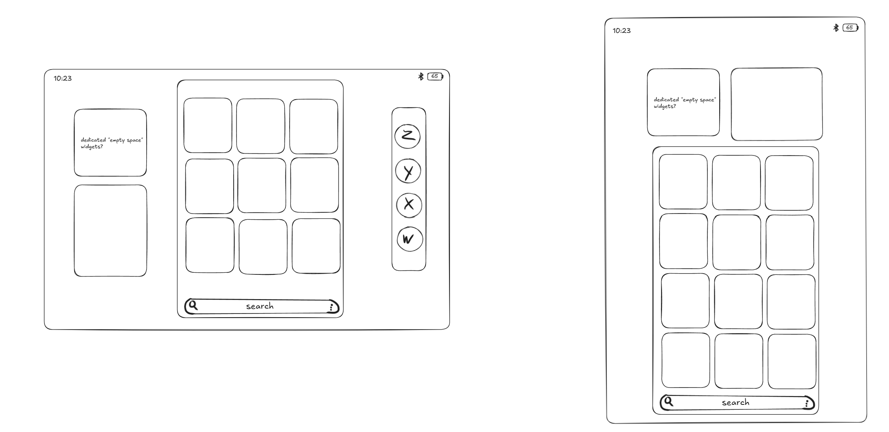

# App drawer

## Layout

- **Swipe up on the home screen** to open the drawer as a **card** that
  takes the place of the app grid. The dock and the widget area stay
  visible beside it, so dock apps can still be launched while the drawer is
  open.
- The card holds **category cards**, as in NothingOS (Social, Productivity,
  Travel and so on; see [nothingos-reference.md](nothingos-reference.md)):
  - landscape: 3 columns, 3 rows visible;
  - portrait: 3 columns, 4 rows visible.
- **Search bar** pinned at the bottom of the card, with a **⋮ menu** that
  opens the app drawer and search settings.

Applies to the square grid layout; see [home-screen.md](home-screen.md).

## How to build it

- Part of the Launcher3 fork. On tablets, Launcher3 already shows the app
  drawer as a floating card over the home screen rather than full screen,
  so the card itself is mostly sizing (match the grid area) and styling.
- **Categories are the new part.** Android only offers a handful of
  developer-set app categories (games, audio, video, images, social, news,
  maps, productivity, accessibility). NothingOS has around 15 categories,
  so we need more data:
  - start from the Android category when the app sets one;
  - add a bundled list mapping common apps to categories;
  - fall back to "Others";
  - let the user move an app to another category.

## App drawer & Search settings

Opened from the ⋮ menu on the search bar. Modelled on NothingOS's page:

- **Drawer layout:**
  - **Default:** a suggestions row, then all apps in a plain alphabetical
    grid.
  - **Smart:** a suggestions row, then the category cards.
- **Show app suggestions:** the suggestions row at the top.
- **Show hidden icons:** whether apps the user has hidden appear in the
  drawer.
- **Search:**
  - **Swipe up to start search:** open the keyboard straight away when the
    drawer opens.
  - **Search results settings:** what search covers (apps, settings,
    contacts, files and so on).
  - **Default search engine:** which engine handles web searches.

### How to build it

- **Default layout** is Launcher3's stock app drawer.
- **App suggestions:** Launcher3's suggestions row is normally filled by
  Google's on-device prediction service, which LineageOS doesn't have. We'd
  write a simple on-device predictor from recent and frequent app usage.
- **Hidden apps:** Lineage's launcher (Trebuchet) may already support hiding
  apps; check its 24.0 source before writing our own.
- **Search scope:** stock Launcher3 search only finds apps. Searching
  settings, contacts and files means adding a search provider for each.
- **Search engine:** web searches open in the browser using the chosen
  engine; no account or Google service involved.

## Open questions

- With more categories than fit, does the card scroll vertically?
- Tapping a category: does it expand inside the card, or open as a pop-up?
- Searching in landscape: the keyboard covers the lower part of the screen,
  including the search bar. Does the card shrink to sit above the keyboard,
  or does the search bar move to the top while typing?
