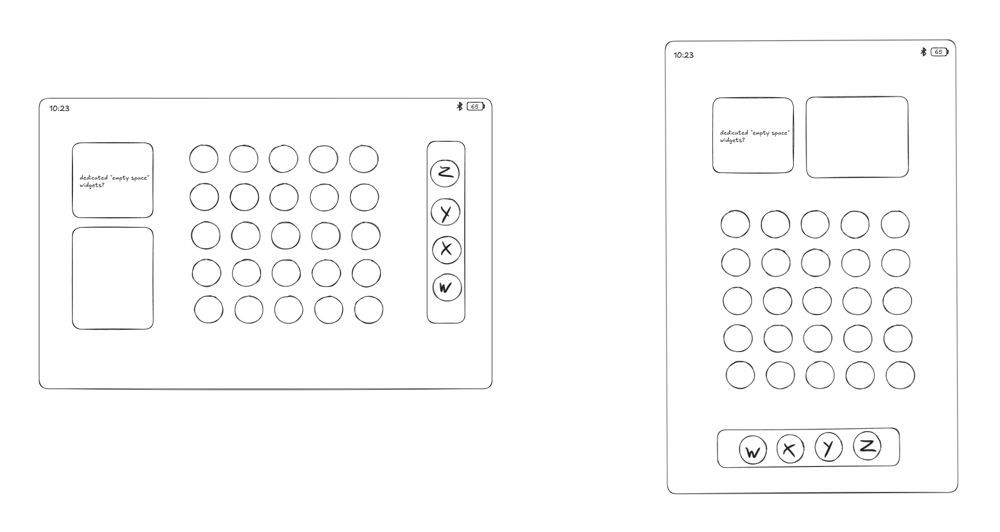

# Home screen

## Layout styles

A setting lets the user choose between two layouts:

- **Square grid (SomethingOS default on tablets):** a fixed 5×5 grid of
  square cells in the centre of the screen, identical in both orientations.
- **Adaptive (standard Android):** Launcher3's normal behaviour, where cells
  stretch to fill the screen.

### Square grid

- Cells stay square, so circles, pills and rounded squares keep the right
  proportions, matching the lock screen widget grid. Community widgets can
  rely on a cell always being the same shape.
- The leftover space on the long side of the screen is used, not left empty:
  - **Dock:** along the bottom in portrait, a vertical column on the right in
    landscape. Its position is tied to the screen, not the physical edge:
    portrait is always bottom (0° and 180°), landscape is always right (both
    directions). Dock order W X Y Z left to right in portrait becomes
    W X Y Z bottom to top in landscape.
  - **Widget area:** a strip of **10 square cells**, the same size as the main
    grid's, above the grid in portrait (5 wide × 2 tall) and to the left of it
    in landscape (2 wide × 5 tall). Enough for two 2×2 widgets plus two 1×1
    items (such as a Quick Settings toggle widget). Square widgets (1×1, 2×2)
    only move when the screen rotates; a pill would turn on its side
    (2×1 ↔ 1×2), so pill widgets there need both orientations.
  - The widget area is **fixed across home screen pages**, like the dock.

### Phones

Phones don't use the square grid. They follow the NothingOS phone home
screen: the standard grid with Nothing-style widgets, folders and dock.

## How to build it

- Part of the Launcher3 fork. Launcher3 already computes its layout from a
  device profile and has selectable grid options (the "App grid" choice in
  Wallpaper & style), so the square grid is a new layout mode alongside the
  stock one rather than a rewrite.
- The widget area is a separate small grid (5×2 / 2×5) that reuses the
  launcher's widget hosting. Rotation maps each cell to its rotated
  position, so placed widgets keep their size and relative arrangement.
