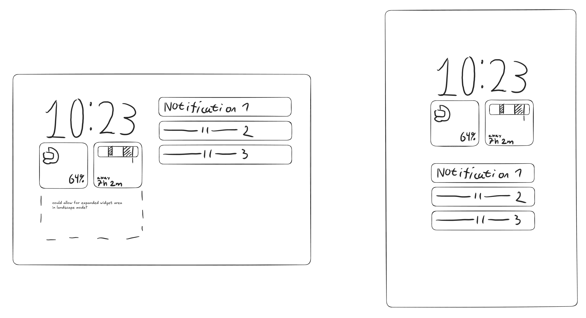
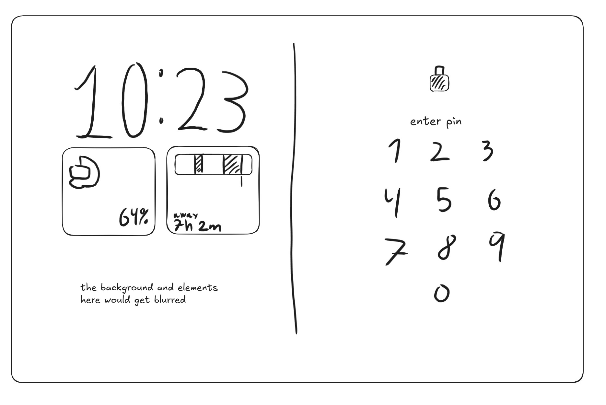

# Lock screen

## Layouts

- **Tablet, landscape:** two columns. Left: large clock, widget grid under
  it, with room for an expanded widget area below. Right: notifications.
- **Tablet, portrait:** one centred column. Large clock, widget grid, then
  notifications. The large clock stays large when notifications arrive.
- **Phone:** the familiar single-column style: large clock, widget row,
  notifications.

All three layouts share the same clock and the same widget grid.

## How to build it

- **Clock:** a lock screen clock plugin (the mechanism Pixels use for their
  clock styles). Possibly shippable from `vendor/somethingos` with an
  allowlist overlay and no SystemUI fork; to be confirmed against the 24.0
  source. Most self-contained piece, so build it first.
- **Layouts:** SystemUI describes the lock screen with "blueprints".
  - Landscape builds on the existing split-shade lock screen, which already
    puts the clock left and notifications right.
  - Portrait and phone get a SomethingOS blueprint that keeps the large
    clock above the widgets and notifications.
  - Needs our `frameworks_base` fork.
- **Widgets:** see [widgets.md](widgets.md).

## PIN entry

Landscape: the screen splits in two.

- **Left:** the lock screen (clock and widgets) stays where it was, with the
  wallpaper and elements blurred behind.
- **Right:** a lock icon, "Enter PIN" and the number pad.

Sizes and proportions in the sketch are provisional.

### How to build it

- SystemUI 24.0's PIN screen ("bouncer") already has a side-by-side layout
  for large screens in landscape (`BouncerOverlayLayout.BESIDE_USER_SWITCHER`):
  the PIN pad on one side, and the user switcher or empty space on the
  other. We show the blurred lock screen in that other half instead.
- Stock Android lets the user double-tap the empty side to move the PIN pad
  there for one-handed use. Keep or drop this; if kept, the blurred lock
  screen moves to the other side.
- The blur uses Android's window blur, which depends on the device's GPU
  support. Check that it's enabled on the Tab S6 Lite; otherwise fall back
  to a dimmed, non-blurred lock screen.
