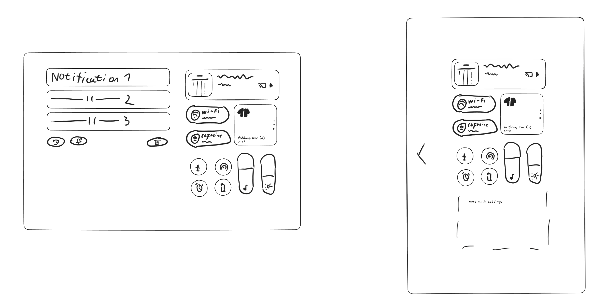

# Quick Settings and notification shade

## Separate or combined

Like NothingOS 5, the user can choose how the shade works:

- **Separate:** swipe down from the top right for Quick Settings, from the
  top left for notifications. Two independent panels.
- **Combined (classic):** one swipe opens a single panel with both.

Behaviour per orientation:

- **Portrait:** follows the user's choice. In Separate mode, a sideways
  swipe swaps between the two panels, as in NothingOS; the arrow at the left
  edge of Quick Settings hints at this. Swiping down from the top left still
  opens notifications directly.
- **Landscape:** both panels open together, side by side, regardless of the
  setting. Notifications on the left, Quick Settings on the right.

## Layout (Quick Settings panel)

From top to bottom:

1. **Media card:** album art, title, artist, output and play buttons.
2. **Large tiles:** pill-shaped 2×1 tiles with label and status (Wi-Fi,
   Caffeine), next to a 2×2 **device card** showing a Bluetooth device and
   its status, with page dots to swipe between devices.
3. **Small tiles and sliders:** round 1×1 tiles (airplane mode, hotspot,
   alarm, rotation) next to two tall vertical sliders: **media volume** and
   **brightness**.
4. **More tiles:** in portrait, the extra height shows more rows of tiles.

When there are more tiles than fit, the panel **scrolls**, as in NothingOS:
the header row (edit, active apps, settings, power) stays fixed at the top,
and everything below it, media card included, scrolls under it. Same in
both orientations.

The notification panel (left in landscape) has notification cards, with
round buttons at the bottom for notification history and notification
settings on the left, and Clear all on the right.

In **portrait Separate mode**, the notification panel on its own is a
**centred column**, the same width as the Quick Settings column: media
card, notification cards, then the history, settings and Clear all buttons,
as on NothingOS phones.

## How to build it

### Separate / combined: Android's dual shade

LineageOS 24.0's SystemUI already has a **dual shade** mode
(`ShadeMode.Dual`): notifications and Quick Settings as independent panels,
opened depending on where you swipe down. It also has the user setting
(`Settings.Secure.DUAL_SHADE`) and a config value for whether that setting is
offered (`config_useDualShadeSetting`).

- It's gated behind build-time feature flags: `dual_shade` and the
  "scene container" SystemUI architecture it depends on. Turning these on is
  the first thing to test on the tab, since the scene container is a big
  internal change.
- The Separate / Combined page in Settings is a front end for the existing
  setting.
- **Landscape "both at once" is not built in.** Google deprecated the old
  side-by-side split shade under the scene container; only single and dual
  remain. We keep dual shade and change landscape so one swipe opens both
  panels side by side. The two panels already exist separately, so this is
  a contained SystemUI change.
- **Horizontal swipe between panels** in portrait: new gesture, SystemUI
  change.

### Tiles

- **Round 1×1 and pill 2×1 tiles:** Android 16+ already has icon-only small
  tiles and wide large tiles, resizable in edit mode. These are restyling.
- **Device card (2×2):** new tile type. Uses the same Bluetooth battery data
  as the Battery lock screen widget.
- **Volume and brightness sliders:** brightness already exists in Quick
  Settings; both need the tall vertical style, and volume needs adding.
- **Media card:** Android's media player, restyled.

### Pop-up panels

Tapping into a tile (Bluetooth devices, Modes, Internet, audio output) opens
a pop-up card: rounded, centred title, simple rows, pill buttons at the
bottom. Android already shows these at a fixed width on large screens, so
they only need restyling. In landscape, anchor them over the Quick Settings
side rather than the centre of the screen, so they don't straddle both
panels.
