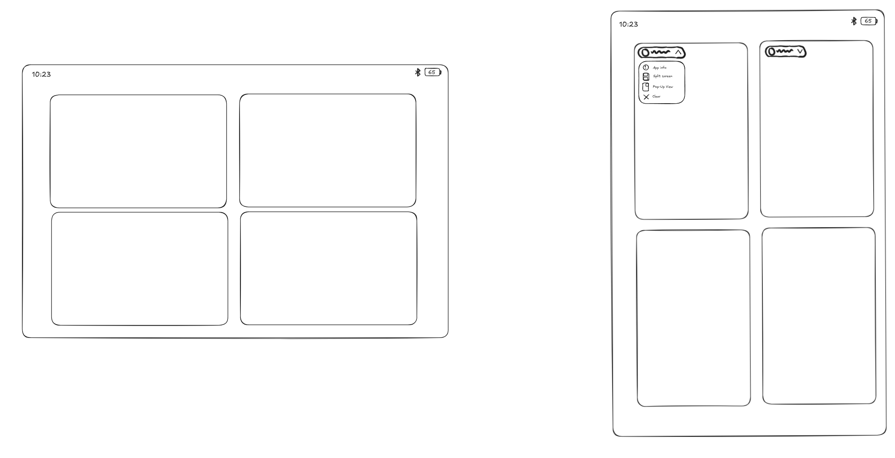

# Recents and multitasking

## Layout

- Recent apps as a **2×2 grid of cards**: wide cards in landscape, tall
  cards in portrait, matching the screen's shape.
- Each card has a **header pill** at the top left: app icon, app name and a
  chevron. Tapping it opens a drop-down menu:
  - **App info**
  - **Split screen**
  - **Pop-Up View** (floating window)
  - **Clear** (close the app)

## Split screen and Pop-Up View

- Split screen is started from the card's drop-down menu, as in NothingOS.
- Pop-Up View opens the app as a floating window over whatever is on
  screen.

## Taskbar / dock

The dock is **only visible on the home screen**. Inside apps there is no
taskbar; navigation uses the normal gesture bar.

## How to build it

- Part of the Launcher3 fork (Launcher3 also draws recents, via its
  "Quickstep" part).
- **Grid:** on tablets Launcher3 already shows recents as a grid (one large
  card plus smaller ones in two rows). The even 2×2 grid is a change to that
  layout.
- **Drop-down menu:** Launcher3 already has a per-card menu opened from the
  app icon, with App info and Split screen among its entries. Restyle it as
  the pill drop-down; Clear replaces swiping a card away (or works alongside
  it).
- **Pop-Up View:** maps onto Android's floating window support (freeform /
  desktop windowing on large screens). Check what LineageOS 24.0 enables on
  the Tab S6 Lite.
- **No taskbar in apps:** Launcher3 shows a taskbar in apps on tablets by
  default; we turn it off and keep the gesture bar, like on phones.

## Open questions

- With more than four recent apps, does the grid scroll vertically or
  horizontally?
- Split screen flow after choosing it from the menu: pick the second app
  from the remaining recents cards, the app drawer, or both? (NothingOS
  reference recording to follow.)
