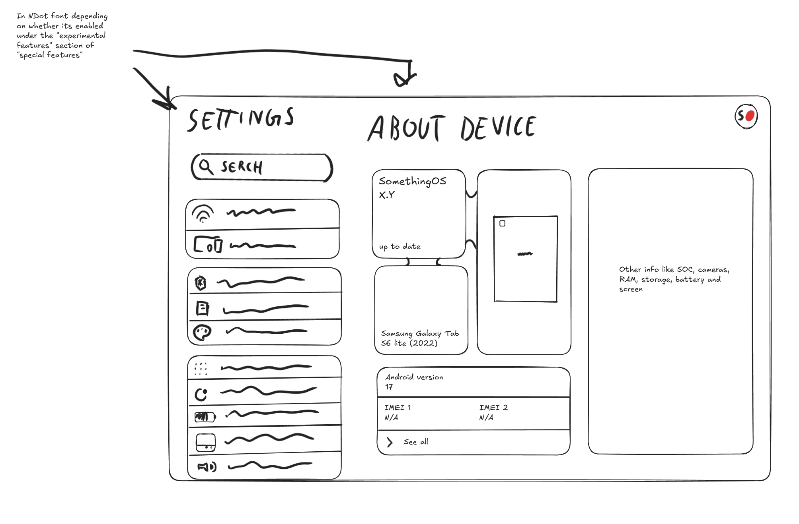

# Settings

## Layout

Two panes on tablets: settings list on the left, the selected page on the
right. Android's Settings already does this on large screens, so the
layout itself is restyling.

- **Titles:** large page titles ("Settings", "About device"), as in
  NothingOS: in the serif (`somethingos-serif`, Old Standard TT, standing in
  for NType) by default, or in capitals in the dot-matrix font
  (`somethingos-dot`) when **Dot matrix title** is on (see Special features).
  Done in our Settings fork (`SomethingTitles`, applied in
  `SettingsBaseActivity`, which every Settings page uses).
- **Search:** pill-shaped search bar at the top of the list. Restyle of the
  existing one.
- **List:** entries grouped into rounded cards with dividers between rows.
  Android 16 introduced a grouped rounded style for Settings; check whether
  24.0 has it, in which case this is mostly spacing, colour and icons.
- **Profile picture (top right):** see below.

## Special features

A **Special features** entry in the main Settings list, in the last group
between *System* and *About*, as in NothingOS. Built in our Settings fork
(`com.android.settings.somethingos`), so its pages are ordinary Settings
pages and look like the rest. Status: works on the Phone (1) (2026-11-18);
the title fonts switch as intended.

Title layout still differs from NothingOS (to do with the Settings
restyle): NothingOS puts the back arrow on its own row with a large title
under it, wrapping onto two lines, while LineageOS's title sits beside a
round back button. The dot-matrix title is also more widely spaced than
NothingOS's.

Contents, in NothingOS's order, added as each is built rather than shown
empty:

- **Experimental features** ("Try upcoming features early"): features still
  being tested. A footer with an info icon explains that they may change.
  - **Dot matrix title**: Settings page titles in capitals in the
    dot-matrix font instead of the serif. That's all it changes. Stored in
    `Settings.Secure` `somethingos_dot_titles`; the current page's title
    changes as soon as it's switched.
  - NothingOS also lists AirPods support and Glyph Progress here; not
    planned yet.
- Gestures
- RAM Booster
- Pop-up view (see [recents.md](recents.md))
- Game Mode

NothingOS ends the page with a "Looking for other settings?" card linking
to its other apps; we'll add one if SomethingOS gets related apps.

## About device

A card layout replacing the standard list. Needs a custom page in our
`packages_apps_Settings` fork.

| Card | Source |
| --- | --- |
| SomethingOS version | `ro.somethingos.version`, set by `config/version.mk` |
| Update status ("Up to date") | the updater app. Needs our own update server eventually; until then, "Check for updates" |
| Device name | per-device value in `products/` |
| Device image | per-device image in `products/` |
| Android version | standard system info |
| IMEI 1 / IMEI 2 | standard system info. **Hidden** on devices without a mobile radio rather than showing "N/A" |
| See all | the full standard status page |
| Specs: SoC, cameras, RAM, storage, battery, screen | read from the device at runtime; cameras via the camera API, or a per-device value if unreliable |

## Profile picture

The circle in the top-right corner shows the **local Android user's
profile picture**, the one set for the device owner in Settings. No online
account is involved:

- signing in with a Nothing account isn't possible or advisable;
- a SomethingOS account would need servers and would bring privacy and
  security obligations, for no clear benefit.

When no picture is set, it shows a small SomethingOS logo. Tapping it opens
the user/profile settings.

## Fonts

Nothing's NDot font is proprietary and can't be shipped.

**Chosen dot font: [Doto](https://fonts.google.com/specimen/Doto)** (SIL Open
Font License), set to **weight 900** and **roundness 100** (both at their
maximum). At those settings it is nearly identical to NDot.

- Doto is a variable font with a weight axis (`wght`, 100–900) and a
  roundness axis (`ROND`, 0–100). SomethingOS ships the unmodified variable
  font (`fonts/Doto-VF.ttf`, installed to `/product/fonts`) and sets the axes
  in the font configuration, the same way LineageOS ships Google Sans Flex.
- It's registered as the font family **`somethingos-dot`** in
  `/product/etc/fonts_customization.xml`, so system apps can use it by name
  (`android:fontFamily="somethingos-dot"`, or `Typeface.create("somethingos-dot",
  Typeface.NORMAL)`). Android reads only one such file and LineageOS already
  ships it (in `packages/overlays/Lineage`), so the entry is added in our
  fork of that repo,
  [Aurora-StFM/android_packages_overlays_Lineage](https://github.com/Aurora-StFM/android_packages_overlays_Lineage)
  (branch `somethingos-24.0`).
- Ship the OFL licence text alongside the font file.
- Used for: large Settings page titles (only when Dot matrix title is
  on). Also available to dot-matrix widgets and the community widget kit.
  Not the lock screen's Dot matrix clock face, which uses a different dot
  style (see [lockscreen.md](lockscreen.md#clock-faces)).

### Other fonts

NothingOS uses two more font families.

**Geist (sans-serif): `somethingos-sans`.** By Vercel, released under the
**SIL Open Font License** with no Reserved Font Name, so SomethingOS ships
Geist itself rather than a look-alike.

- NothingOS lets the user choose the **system font** in *Font and display
  size*: **Roboto** or **Geist**, each shown as an "Aa 123" preview card,
  with Cancel / Apply. SomethingOS offers the same two.
- **Geist is the default.** `FontGeistOverlay` is a static overlay (always
  on) that sets Android's UI font families to `somethingos-sans`. Its
  priority (2) is above LineageOS's Google Sans Flex overlay (1), which it
  replaces.
- **Roboto** is `FontRobotoOverlay`, a switchable font overlay (category
  `android.theme.customization.font`) that sets them back to `sans-serif`.
  The picker enables it for Roboto and disables it for Geist. On its own it
  only switches part of the UI back (see below); the rest needs the picker.
- **Why overlays alone aren't enough.** LineageOS's font list also defines
  the `google-sans…` families and about 30 `variable-…` families (Material 3
  text styles), all pointing at Google Sans Flex. Settings, SystemUI and the
  launcher often ask for these by name, so the overlays above only change
  part of the UI. The font list itself is fixed at build time.

#### How the font switcher works

Android's own **updatable system fonts** (the mechanism Google uses to
update fonts through Play) can redefine *named* font families at runtime:
families defined later override earlier ones with the same name
(`UpdatableFontDir.getSystemFontConfig()` in `frameworks/base`). The
pieces:

- A privileged app with the `UPDATE_FONTS` permission installs font files
  into the updatable font folder (`FontManager` update), then sends new
  definitions for named families (`updateFontFamily`).
- Installed font files must carry an fs-verity signature from a certificate
  listed in the framework's `config_fontManagerServiceCerts`. As the ROM
  maker we can add our own certificate. Same-or-newer font versions are
  accepted, so unmodified copies of Geist and Roboto work.
- Requires fs-verity support on the device (standard on devices launched
  with Android 11 or later).

**Status: proven on the Nothing Phone (1)** (2026-11-15). Installing a
signed Geist through `cmd font update` and redefining the 40 `google-sans…`
and `variable-…` families with `cmd font update-family` switched the whole
UI to Geist at runtime. Our certificate is trusted via
`config_fontManagerServiceCerts` in `SomethingFrameworkOverlay`, with the
public certificate at `/product/etc/security/fsverity/somethingos-fonts.der`.

Plan:

1. **Default (build time), done (2026-11-15), to be checked on a device:**
   our overlays fork points the `google-sans…` and `variable-…` families at
   Geist, so the whole UI is Geist from first boot, before anything is
   installed at runtime. Android rejects duplicate family names in that
   file, so the families are rewritten in place by
   `tools/fonts/use_geist.py` (rerun after each rebase). Geist has no
   italic or optical-size axes: italic text uses Android's slanted Geist,
   and Google Sans Flex's other axes are dropped.
2. **Signed font files:** runtime families can only use fonts installed
   through the updater, not fonts already in the system image, so the
   picker installs both Geist and Roboto, even though Geist is the default.
   It installs the copies already on the device
   (`/product/fonts/Geist-VF.ttf`, `/system/fonts/Roboto-Regular.ttf`), so
   only their signatures are shipped. The maintainer creates them with
   `tools/fonts/sign_fonts.sh`, which pulls the fonts from a device, signs
   them with the SomethingOS font-signing key and test-installs them. The
   `.sig` files (not the key) are committed to `fonts/signatures/` and
   installed to `/product/etc/somethingos/fonts/`. Done 2026-11-15. A
   signature covers the exact file, so rerun the script if Roboto changes
   in a LineageOS update.
3. **The picker**: `apps/FontPicker` (`SomethingFontPicker`, package
   `org.somethingos.fontpicker`), a privileged system app with
   `UPDATE_FONTS`. On **Apply** it installs the chosen font with its
   signature, redefines every `google-sans…`/`variable-…` family to it
   (keeping each family's weights), and switches `FontRobotoOverlay`
   through SystemUI's theme setting. Runtime switching is proven on the Phone (1),
   and the dialog's look was confirmed there on 2026-11-18.
   - **Where it appears:** a **Default font** row, with the current font as
     its summary, at the top of *Size options* in Settings > Display > *Font
     and display size*, as in NothingOS. That page is built in code
     (`TextReadingScreen.kt`) and doesn't accept injected Settings tiles, so
     the row comes from our fork of `packages/apps/Settings`
     (`SystemFontPreference.kt`, 3 files, marked "SomethingOS"). The row
     opens the picker; it isn't shown in the setup wizard or if the picker
     isn't installed.
   - **Look:** a floating rounded dialog over the page (not a full page):
     two "Aa 123" preview cards side by side, each in its own font, with
     the font's name under it. The selected card is outlined and its name
     sits in a filled pill. Cancel (outlined pill) and Apply (filled pill)
     at the bottom right. Dark grey in dark theme, light grey in light
     theme. Width: the screen minus 24dp each side, at most 440dp on
     tablets.
4. **Applying:** running apps keep their old fonts until they restart.
   After Apply, the dialog asks to **restart**: SystemUI (status bar, Quick
   Settings, lock screen) is a persistent process, and Android won't let
   another app restart it (`forceStopPackage` skips persistent processes),
   so it only switches after a reboot. **Later** restarts Settings and the
   launcher and reopens *Font and display size*; everything else switches
   at the next reboot. Once we fork `frameworks_base` (planned for the lock
   screen), SystemUI can restart itself when the font changes, as in
   NothingOS, and the prompt can go.

**NType (serif): Old Standard TT, `somethingos-serif`.** NType is Nothing's
own serif, used for titles such as the Glyph app's, "App drawer & Search"
and "Nothing Machines (1)". It's proprietary; **Old Standard TT** (SIL
OFL 1.1) is a close open-licence match (regular, italic and bold).

All three families are registered in our fork of `packages/overlays/Lineage`
(`fonts/etc/fonts_customization.xml`); the font files live in
`vendor/somethingos/fonts//` with their licences.
