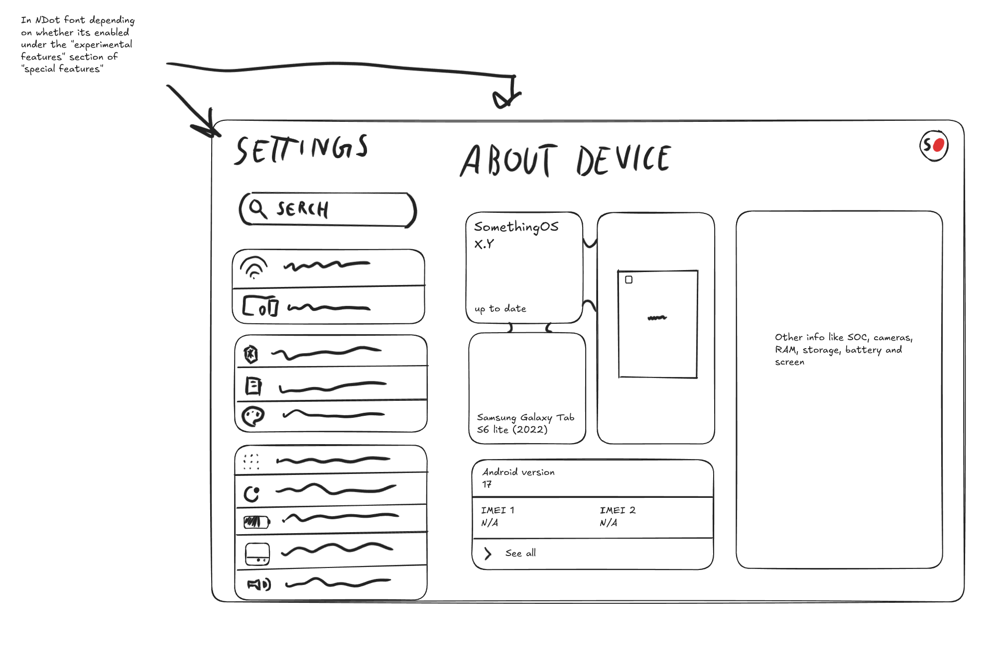

# Settings

## Layout

Two panes on tablets: settings list on the left, the selected page on the
right. Android's Settings already does this on large screens, so the
layout itself is restyling.

- **Titles:** large page titles ("Settings", "About device"). Rendered in a
  dot-matrix font when the experimental **Dot font** toggle is on (see
  below). Needs a small Settings patch, since a static overlay can't switch
  fonts based on a setting.
- **Search:** pill-shaped search bar at the top of the list. Restyle of the
  existing one.
- **List:** entries grouped into rounded cards with dividers between rows.
  Android 16 introduced a grouped rounded style for Settings; check whether
  24.0 has it, in which case this is mostly spacing, colour and icons.
- **Profile picture (top right):** see below.

## Special features

A SomethingOS section in the main Settings list, provided by a small
SomethingOS settings app. Android lets other apps inject entries into
Settings (this is how Lineage adds its own), so no Settings fork is needed
for it. First contents:

- **Experimental → Dot font:** use the dot-matrix font for titles.

## About device

A card layout replacing the standard list. Needs a custom page in our
`packages_apps_Settings` fork.

| Card | Source |
| --- | --- |
| SomethingOS version | `ro.somethingos.version`, set by `config/version.mk` |
| Update status ("Up to date") | the updater app. Needs our own update server eventually; until then, "Check for updates" |
| Device name | per-device value in `products/` |
| Device image | per-device image in `products/` |
| Android version | standard system info |
| IMEI 1 / IMEI 2 | standard system info. **Hidden** on devices without a mobile radio rather than showing "N/A" |
| See all | the full standard status page |
| Specs: SoC, cameras, RAM, storage, battery, screen | read from the device at runtime; cameras via the camera API, or a per-device value if unreliable |

## Profile picture

The circle in the top-right corner shows the **local Android user's
profile picture**, the one set for the device owner in Settings. No online
account is involved:

- signing in with a Nothing account isn't possible or advisable;
- a SomethingOS account would need servers and would bring privacy and
  security obligations, for no clear benefit.

When no picture is set, it shows a small SomethingOS logo. Tapping it opens
the user/profile settings.

## Fonts

Nothing's NDot font is proprietary and can't be shipped.

**Chosen dot font: [Doto](https://fonts.google.com/specimen/Doto)** (SIL Open
Font License), set to **weight 900** and **roundness 100** (both at their
maximum). At those settings it is nearly identical to NDot.

- Doto is a variable font with a weight axis (`wght`, 100–900) and a
  roundness axis (`ROND`, 0–100). Either ship the variable font and set the
  axes in the font configuration, or generate a fixed instance at
  `wght 900, ROND 100` with fontTools to keep it small and simple.
- Ship the OFL licence text alongside the font file.
- Used for: large page titles (when the Dot font option is on), the
  lock screen clock, dot-matrix widgets and the community widget kit.
