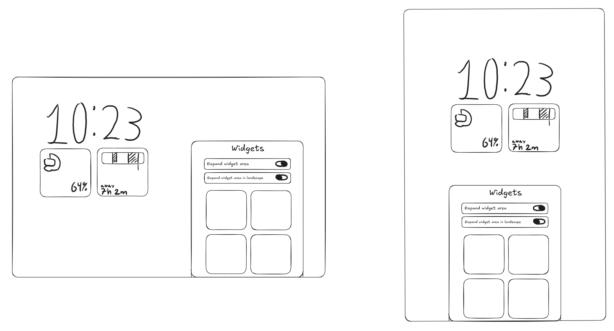

# Lock screen widgets

The most important property is **customisability**: users pick, arrange,
resize and remove widgets freely. Long term we want three kinds of widget
side by side:

1. Our own SomethingOS widgets (the catalogue below).
2. Any app's normal Android widgets.
3. Community widgets.

## Grid and editing

- A grid under the clock with four cell shapes: **circle** (1×1),
  **pill** (1×2 and 2×1) and **rounded square** (2×2).
- An edit mode: remove button on each widget, drag to rearrange,
  Cancel / Done, and a **Widgets** sheet (below).
- **Expand widget area** toggle: hides the main clock and gives its space to
  widgets.
- **Expand widget area in landscape** toggle: on tablets in landscape, uses
  the empty area under the left column for more widgets. Separate from the
  first toggle, so landscape can have extra widgets while portrait keeps the
  big clock.

## Customising the lock screen

- **Entry:** long-press an empty part of the lock screen until a
  **Customise lock screen** button pops up; tap it. Android asks for the PIN
  first, so nobody can change the lock screen of a locked device.
- The lock screen stays visible while editing, with a sheet over part of
  it:
  - **landscape:** a card at the bottom right, leaving the clock and
    widgets on the left in view;
  - **portrait:** a card at the bottom centre, below the clock and widgets.
- The **Widgets** sheet has the two Expand toggles at the top, then the
  widget picker as a scrollable two-column grid of previews.
- Tapping the clock opens the **Clock face** sheet in the same card style
  (see [lockscreen.md](lockscreen.md#clock-faces)).

## How to build it

LineageOS 24.0's SystemUI already contains a full lock screen widget system
(the "glanceable hub", `packages/SystemUI/src/com/android/systemui/communal`),
switched off by default with `config_communalServiceEnabled`. It already has:

- an AppWidget host that runs widgets from any app;
- a Room database storing the layout, with per-widget spans;
- an edit activity with picker, remove, rearrange and widget configuration;
- lock screen rules: widget categories (`WIDGET_CATEGORY_KEYGUARD`) and an
  allowlist (`config_communalWidgetAllowlist`).

Plan:

1. Turn it on with an overlay in `vendor/somethingos` as a working baseline.
2. Render its grid inline under the clock instead of as a separate
   swipe-to page (`frameworks_base` fork).
3. Restyle cells to the circle / pill / square shapes and the edit mode to
   the SomethingOS look.
4. Add the two Expand widget area toggles.

### Edit mode

- Android already has the long-press entry: a "Customise lock screen"
  button that opens the Wallpaper & style app after unlocking. We keep the
  gesture and point it at our edit mode.
- Edit mode is a full-screen screen showing a live preview of the lock
  screen (SystemUI can render one for other apps; Wallpaper & style uses
  this) with our sheet over it. Widget changes go through the hub's widget
  storage, clock changes through the clock settings.

### SomethingOS widgets are ordinary Android widgets

Our widgets ship as standard AppWidgets in their own app (working name
**SomethingWidgets**). This means:

- they work on the lock screen *and* the home screen with the same code;
- third-party widgets work in the same grid;
- community widgets are simply apps that provide widgets. We can publish a
  small kit (shape guidelines, sizes, an open-licence dot-matrix font) so
  they fit in.

Trade-off: AppWidgets can't animate freely. Clocks are fine (Android
redraws them itself); most others update every minute or on events. Live,
fast-updating widgets such as a compass need special handling.

## Catalogue

| Widget | Notes |
| --- | --- |
| Analogue clock | straightforward |
| Digital clock | dot-matrix digits; straightforward |
| World clock | straightforward |
| Date | straightforward |
| Countdown | straightforward |
| Photos | straightforward |
| Collector | photo cut-out; straightforward |
| Away Time | timeline bar of time away from the device; needs usage stats (system app) |
| Screen Time | needs usage stats (system app) |
| Battery | this device plus connected Bluetooth devices; needs Bluetooth battery info |
| Quick Settings | toggles such as flashlight and auto-rotate; needs system permissions |
| Weather | needs a provider; Lineage has none. Open-Meteo is free with no account |
| Sunrise / sunset curve | same weather provider |
| Precipitation chance | same weather provider |
| Pedometer | needs a step-counter sensor; not on the Tab S6 Lite, fine on phones with one |
| Compass | needs faster updates than a normal widget |
| Essential Space, Headlines, Fortunes | depend on Nothing's servers; skip or design our own equivalents |
